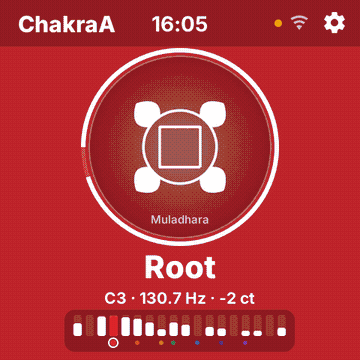
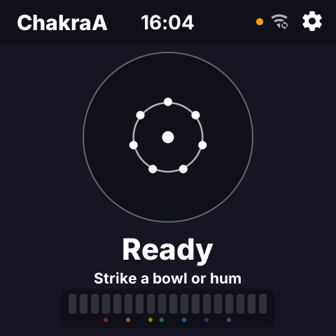
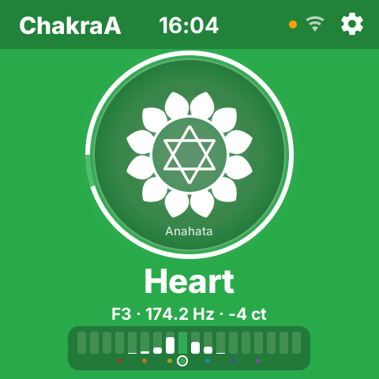
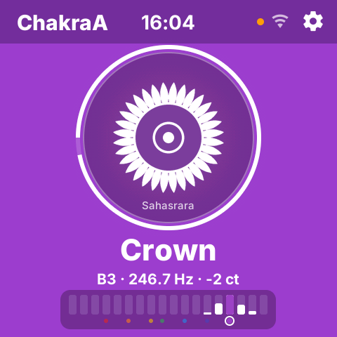
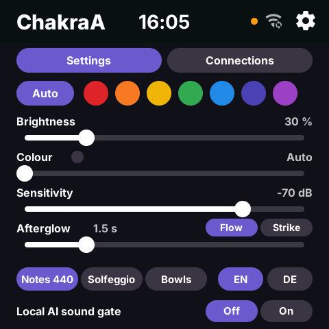
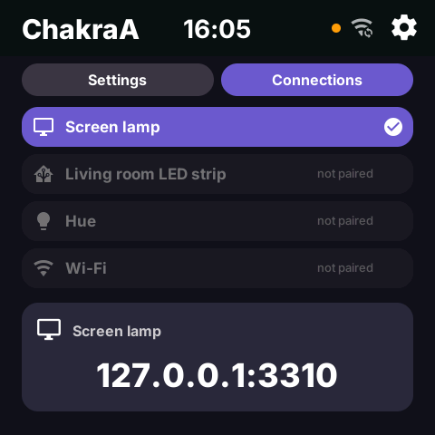
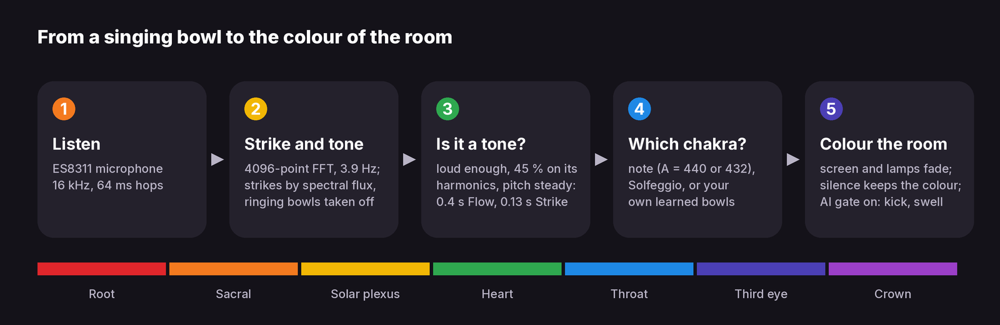
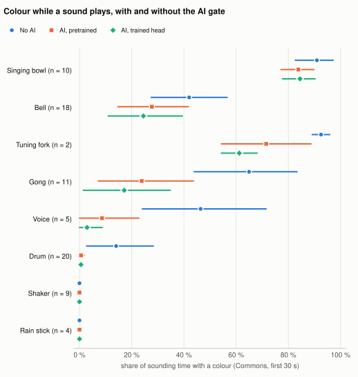

# ChakraA: Chakra Detection


**Strike a singing bowl. The room takes its colour.**

An open-source app for Espressif's [ESP-Mosaico](https://mosaico.espressif.com) (ESP32-S31, 2.16" 480 x 480
touch screen, microphone). It hears a singing bowl, a tuning fork or a hummed tone, shows the chakra like a
tuner and colours the room: the screen itself, your lamps (Philips Hue, Home Assistant, WiZ) and any TV or
laptop browser as a screen lamp. Made for sound healing journeys: put it in the middle of the room and play.

**Which one?** Two apps, one code base. In yoga and sound healing many people want no AI at all, or only AI
that stays in the room: ChakraA is built for that. It works without any AI, and its one AI feature runs on
the device, with no camera and no cloud. ChakraV is the experimental sibling that tries what a camera and
bigger models can add. (ChakraA: the audio one. ChakraV: with video.)

| | [ChakraA](https://github.com/leopardcodeai/chakraa) (this one) | [ChakraV](https://github.com/leopardcodeai/chakrav) |
|---|---|---|
| Listens | microphone | microphone and camera |
| AI | none needed; an optional local AI sound gate, on the device only | as much on the device as the ESP32-S31 runs, plus optional cloud models with your own API key |
| For | rooms where a camera is not wanted: the classic, private choice | experiments: what can it see and mark? |

<p align="center"></p>

| Ready | A bowl sounds | Crown | Settings | Connections |
|---|---|---|---|---|
|  |  |  |  |  |

## What it does

- **Hears the tone, not the noise.** Only a loud enough tone that holds its pitch and carries most of its
  energy on its harmonics changes the colour. Drums, rattles and rain sticks mostly leave it alone.
- **Hears every strike.** Each strike is found on its own (spectral flux), so a bowl struck while a louder
  one still rings takes the colour.
- **Shows it like a tuner.** Chakra, Sanskrit name, note, Hz and cents; a ring fills the closer the tone sits
  to its note; a semitone spectrum with the seven chakra dots under their notes.
- **Colours the room.** The screen fades to the colour, ticked lamps follow, and the screen lamp page
  (`/lamp` on the board) turns any browser in fullscreen into a lamp.
- **Calm light.** 30 % brightness by default, soft fades, at most 8 lamp commands a second.
- **Flow or Strike.** Flow (default) waits 0.4 s for a steady tone, made for a journey. Strike reacts in
  0.13 s, for practice and learning bowls.
- **Three mappings.** Notes (C root to B crown, A = 440 or 432 Hz), Solfeggio (396 to 963 Hz), or **your
  own bowls**: strike each of your seven once and the app learns them.
- **Your colour, if you like.** Auto follows the chakra; a fixed colour stays.
- **Local AI sound gate** (optional, off by default): only bowl-like sounds change the colour; a strike
  gives a small light kick, a gong a slow swell. Nothing leaves the device.
- **English and German.** Hold the top bar for 3 s to close the app.



<details>
<summary><b>The light and the AI gate in detail</b></summary>

- **Kick.** With the gate on, a strike adds 8 brightness points and moves 8 % towards white, at most once
  every 2 s: a drum at 4 beats a second never flashes per beat, and the change stays under the WCAG flash
  line for every colour. Two lamp commands per kick (one up, one down).
- **Gong swell.** A gong never kicks and never changes the colour: the lamps swell 12 points over 1.5 s and
  fall back over 7 s. A second head tells gongs from other sounds (`tools/bench/gong_head.py`; it finds
  45 % of the Commons gongs and 33 % of our own; a gong it misses gets the small kick).
- **Lamp pace.** One command per colour change, a Hue bridge or Home Assistant at most 8 a second (Hue takes
  about 10). Brightness was 60 % before 26 October 2026; a stored setting stays as it was.
- **The gate.** EfficientAT mn05 with a small head trained on freely licensed recordings
  (`tools/ai_gate.py`, `chakra_feed.py mic --ai` on the Mac). On the board it is meant for the ESP32-S31's
  AI instructions through ESP-DL: about 1.9 MB at 8-bit weights and 16-bit activations, estimated 30 to 60
  ms per second of audio, to be measured when the board is here. While no gate speaks for 5 s the detection
  leads alone, so the room never stays dark because of it.
- **The symbols** are the project's own artwork, drawn from geometry (petal count and inner figure of each
  chakra): 

</details>

## How well it works

Evaluation of 26 October 2026, the app's own C detector over real recordings. Means or medians with 95 %
bootstrap intervals over recordings.

| Measure | Flow | Strike |
|---|---|---|
| Strikes that show the right chakra (8 recordings, 70 strikes) | 83 % [71, 93] | 87 % [79, 96] |
| of these, public tune-up videos only (2 videos, 28 strikes) | 71 % [43, 81] | 75 % [57, 81] |
| From the strike to the right colour, median | 0.29 s (n = 45) | 0.03 s (n = 47) |
| Colour changes a minute in sessions on the body (10 videos) | 7.5 [4.9, 8.2] | 15.0 [11.4, 19.1] |
| Sessions with more than 3 changes in any second (flicker limit) | 0 of 10 | 2 of 10 |

**With and without the local AI sound gate** (79 Wikimedia Commons clips): gongs colour the room 65 % of
their sounding time without the gate and 17 % with it, voices 46 % and 3 %, drums 14 % and 1 %, while
singing bowls keep their colour 84 % of the time (91 % without). The price: bells lose colour too.

<p align="center"><picture><source media="(prefers-color-scheme: dark)" srcset="docs/evaluation/figures/gate-dark.svg"></picture></p>

Learned on the way: a tune-up video's "root" bowl rings at G#3 (208 Hz), so by note the app calls it
Throat. Real bowls are rarely tuned to C to B: learn your bowls. Small n, one set of own bowls, one
person's labels: the full report with definitions, data, sources and limitations is
[docs/evaluation/report.md](docs/evaluation/report.md). Own recordings appear there as numbers only.

<details>
<summary><b>The evaluation pipeline</b></summary>

`tools/bench/pipeline.py` makes every number above from one command, in stages: fetch the Commons clips,
export and label the own videos, run the detector over every recording in Flow and Strike, score it against
known strikes, run the AI gate bench, measure the light (`tools/light_timeline.py`: changes a minute, short
colours, flicker), and write the report. Each run gets its own folder with the config, the commits of both
chakra repositories and hashes of code and data lists. Strike times come from the owner's hand marks, the
known order root to crown aligned to the spectral flux (within 0.04 s of checked marks), and the public
videos' own chapters and spoken captions (`tools/bench/strike_truth.json`). Run it with
`tools/bench/pipeline.py --dry-run`, then without; details in [tools/bench/README.md](tools/bench/README.md).
The Commons clips and videos are used for testing only; none ships with this repository.

`tests/analyse.sh FILE` runs the same detection over any audio file and prints when which chakra was shown.

</details>

## Try it without the board

You need macOS or Linux, Python 3 and ffmpeg. The app runs in Espressif's ESP-GSP simulator, fed by your
computer's microphone.

```sh
git clone https://github.com/esp-mosaico/esp-mosaico-vibe workspace   # Espressif's workspace (once)
git clone https://github.com/leopardcodeai/chakraa apps/chakra
cd apps/chakra
./sim.sh --mic                           # browser preview at http://127.0.0.1:3222, your microphone
python3 tools/chakra_feed.py demo        # or: seven bowl tones, root to crown
python3 tools/chakra_feed.py tone 174.6  # one tone
tests/run.sh                             # host tests: detection, kick, gong swell, lamp pace
tests/analyse.sh my_bowls.wav            # any recording
```

<details>
<summary><b>More simulator options</b></summary>

`sim.sh` expects this folder next to the workspace (`../../workspace`). With `CHAKRA_LIGHT=light.x`,
`HA_URL` and `HA_TOKEN` in the environment the simulator also colours that Home Assistant lamp.
`python3 tools/chakra_feed.py mic --lamp http://127.0.0.1:3310` sends every light command to a screen lamp
page instead (the line `light\t<chakra>\t<RRGGBB>\t<bright>\t<transition>`, POSTed to `/light`, with the
`reading` lines: names, note, Hz, cents). `CHAKRA_LAMP_URL` sets the address the Connections page shows
(default `127.0.0.1:3310`). `chakra_feed.py wav FILE --loop` plays a recording; `--speaker FLAGFILE` also
plays its sound on the Mac while the flag file exists. `tools/screens.py OUTDIR` takes the screenshots and
the GIF above from synthetic tones.

</details>

## On the board

1. Install the app: `python3 mosaico.py iris system-update --project ../apps/chakra` from the workspace,
   then "Save Current Build" in Vibe Mode, the Mosaico's app launcher.
2. Lamps and extra Wi-Fi networks: copy `tools/provision.example.json`, fill in your lamps, put the secrets
   into the environment (`CHAKRA_HA_TOKEN`, `CHAKRA_HUE_KEY`, `CHAKRA_WIFI_PASS_1`), run
   `tools/provision.py --port <port> --dry-run`, then without `--dry-run`.
3. Philips Hue: press the bridge's link button, then `tools/hue_pair.py --host <bridge address>`.

Bluetooth lamps are paired in Home Assistant (they then appear as Home Assistant lights), WiZ bulbs by
their address.

**Security.** Use a `wss://` Home Assistant address (checked against the certificate bundle) and a Home
Assistant user that may only switch lights; over `ws://` the token travels unencrypted. The Hue path uses
the bridge's local v1 API over plain HTTP, so keep the device on a network you trust. Tokens, keys and Wi-Fi
passwords never sit in a file of this repository: `provision.py` reads them from the environment and writes
them straight to the board.

Status: runs in the simulator and builds for the ESP32-S31; the board is on order, so it is untested on
hardware.

## How it is built

| Part | File |
|---|---|
| Detection: FFT, harmonics, steadiness, strikes (spectral flux), mappings, learned bowls | `components/app_chakra/chakra_detect.c` |
| Screen: fades, symbols, tuner ring, settings, learning | `components/app_chakra/chakra_core.c`, `ui/make_scene.py` |
| Light: kick, gong swell, the gate's colour rule, lamp pace | `components/app_chakra/chakra_light.c` |
| Board: microphone, Wi-Fi, Home Assistant, Hue, WiZ, the screen lamp page, settings | `main/main.c` |
| Simulator side, feeder, screenshots | `components/app_chakra/host/platform_pc.c`, `tools/chakra_feed.py`, `tools/screens.py` |
| Tests | `tests/test_detect.c`, `tests/test_light.c`, `tests/analyse_wav.c` |
| Evaluation | `tools/bench/pipeline.py`, `tools/light_timeline.py` |

The detection is plain C with no dependencies, so the board, the simulator and the tests run the same code.
It replaces four generations of an ESPHome firmware for the ESP32-S3-BOX-3 (2025 to 2026), whose 512-point
FFT gave 31 Hz bins, two semitones at 250 Hz.

## Licence

Apache-2.0. Made by [LeopardCode.AI](https://leopardcode.ai). Chakra colours, names and the C-to-B note
assignment follow common sound healing practice; this is a light and sound tool, not a medical device.
