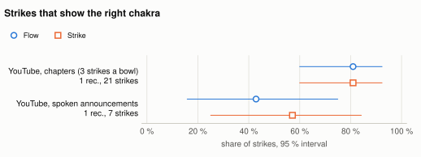
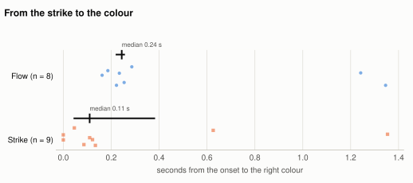
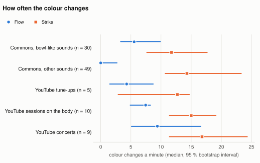
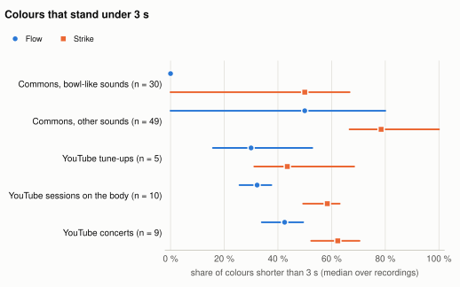

# ChakraA: how well the app hears a singing bowl

*Run 2026-10-26_231334, chakra f72b136, public variant*

## Summary

- **Strikes:** Flow shows the right chakra for 21 of 28 strikes (75 % [57, 81]), Strike for 22 of 28 (79 % [71, 81]); 2 recordings (YouTube only).
- **Latency** from the onset to the right colour, median: Flow 0.25 s [0.22, 0.28] (n = 9), Strike 0.10 s [0.05, 0.73] (n = 10).
- **The owner's own rounds** (seven bowls struck root to crown, 6 recordings, shown here as numbers only): Flow 40 of 42, Strike 41 of 42 strikes right.
- **AI gate** (mn05, 79 Commons clips): sounds that should colour keep 63 % [49, 76] without AI, 53 % [39, 66] pretrained, 50 % [36, 63] with the trained head; sounds that should not colour drop from 25 % [15, 36] to 7 % [2, 12] and 4 % [1, 10] (n = 30 and 49).
- **Light in real sessions** (10 YouTube sessions): Flow 7.3 [4.2, 8.4] colour changes a minute, Strike 14.5 [11.3, 22.5]; recordings with more than three changes in any second: Flow 0, Strike 2.

Every number carries its n. Intervals are 95 % percentile bootstrap intervals over recordings (10000 draws, seed 26102026): recordings, not strikes or windows, are the independent unit.

## Data

| Set | Recordings | Hours | What | Data list hash |
|---|---|---|---|---|
| Wikimedia Commons clips | 79 | 0.82 | free licences, 8 classes (fetch_clips.py) | `b89c100897ac` |
| YouTube videos | 24 | 4.49 | tune-ups, sessions on the body, concerts; not redistributed | `5d0a01aee0ea` |
| Own recordings | 20 | 0.61 | the owner's rounds and sessions; private, counted only | `957e45784bd5` |

Left out as duplicates: CPlC2404Ils (the same audio as u1KjQTAHSlo under another channel, shifted by 1.7 s). Commons clips are single recordings of one instrument, not sessions; the YouTube and own sessions are the nearest thing to a room.

**Data cleaning:** 17 entries of the Commons source lists are recordings of someone saying the word ('shaker', 'gong', 'maraca': Lingua Libre and Wiktionary pronunciations), not the instrument; they are left out (fetch_clips.PRONUNCIATION). Up to 25 October 2026, 12 such files were counted among the benchmark's 91 clips (11 as shakers, 1 as a gong).

## Method

- **Detector:** the app's own C code (`chakra_detect.c` through `tests/analyse_wav.c`, built into the run folder), notes at A = 440 Hz, sensitivity 8. **Flow** locks a tone after 384 ms and switches after 1500 ms; **Strike** after 128 and 256 ms. Both have the strike path (spectral flux) that lets a new bowl take over a louder ringing one.
- **Onsets** (reference, independent of the detector's decisions): peaks of the rectified log-magnitude spectral flux, 60 to 4000 Hz, 16 ms hops, corrected by 42 ms so a synthetic strike is found within 10 ms.
- **A strike is right** when its chakra is shown at some time from 0.1 s before the onset until the next strike or 3 s, whichever comes first. **First colour right**: the first colour that starts in that window is the right one. **Latency**: from the onset to the start of the right colour; a strike whose colour already showed (the same bowl again) counts for accuracy, not for latency.
- **Colour share:** the share of the sounding time (RMS above 3 % of the loudest 0.1 s) with any colour. The gate comparison uses gate_bench.py's own time base: the first 30 s of each clip.
- **Light:** colour changes a minute (a new chakra, or colour to dark), the share of colours that stand under 3 s, and the most changes in any 1 s window against the photosensitivity guidance of at most three flashes a second (light_timeline.py).
- **AI gate:** EfficientAT mn05 on 2 s windows; pretrained = the best bowl-like AudioSet class beats the best other class; trained = a logistic head on the embedding, 5-fold by clip (a clip is never in its own training).

### Ground truth and how far to trust it

| Source | Chakra from | Strike time from | Reliability |
|---|---|---|---|
| Own rounds, hand-marked | a person marked each strike and its bowl (frames, or flux onsets checked against a contact sheet) | the flux onset found by the order alignment, when it lies within 1.6 s of the mark | chakra high; time high where the marks were checked (see validation) |
| Own rounds, derived | the seven bowls are struck root to crown (the owner's set, tuned C3 to B3) | onsets aligned to that order by dynamic programming: each bowl takes the onset where its fundamental gained most new energy | chakra high; time medium, validated on the round with checked marks |
| YouTube, chapters (-ar9vsmFhJU) | the player's chapter list, root to crown, 'each bowl is struck 3 times' | the 3 strongest onsets of each chapter, at least 4 s apart | chakra high; time medium |
| YouTube, announced (u1KjQTAHSlo) | automatic captions: the seller names each bowl's chakra and note | the strongest onset after the sentence and before the next one | chakra high; time medium |
| YouTube, crystal chapters (8Qhh2VF1Oz4) | chapter numbers read as chakra numbers, as the description says | none (bowls rung on): only the share of chapter time with the intended colour | medium |

**Validation of the derived strike times:** the order alignment, run without the marks, against the hand marks of the two marked rounds.

| Round | Strikes | Median offset | Largest | Within 0.1 s | Marks from |
|---|---|---|---|---|---|
| own round 1 | 7 | 1.12 s | 1.53 s | 0 of 7 | marks from 1 fps frames |
| own round 2 | 7 | 0.03 s | 0.04 s | 7 of 7 | checked marks |

Where the marks were checked against the flux, the alignment finds the same strikes within a few hundredths of a second; where they came from video frames at one a second, the frames lag the sound by up to 1.5 s, so those marks give the bowl but not the time.

## Results

### Strikes

| Ground truth | Mode | Recordings | Strikes | Right | Accuracy [95 % CI] | First colour right | Latency, median [95 % CI] |
|---|---|---|---|---|---|---|---|
| YouTube, chapters (3 strikes a bowl) | Flow | 1 | 21 | 17 of 21 | 81 % | 81 % | 0.22 s (n = 5) |
| YouTube, chapters (3 strikes a bowl) | Strike | 1 | 21 | 17 of 21 | 81 % | 76 % | 0.05 s (n = 5) |
| YouTube, spoken announcements | Flow | 1 | 7 | 4 of 7 | 57 % | 57 % | 0.28 s (n = 4) |
| YouTube, spoken announcements | Strike | 1 | 7 | 5 of 7 | 71 % | 57 % | 0.73 s (n = 5) |
| Own rounds, hand-marked strikes | Flow | 2 | 14 | 14 of 14 | 100 % [100, 100] | 100 % [100, 100] | 0.29 s [0.28, 0.30] (n = 14) |
| Own rounds, hand-marked strikes | Strike | 2 | 14 | 14 of 14 | 100 % [100, 100] | 100 % [100, 100] | 0.00 s [0.00, 0.01] (n = 13) |
| Own rounds, derived strike times | Flow | 4 | 28 | 26 of 28 | 93 % [86, 100] | 93 % [86, 100] | 0.29 s [0.29, 0.31] (n = 25) |
| Own rounds, derived strike times | Strike | 4 | 28 | 27 of 28 | 96 % [89, 100] | 96 % [89, 100] | 0.02 s [0.00, 0.05] (n = 26) |

Own rounds with derived times: 5 of 28 strikes are flagged uncertain (their bowl gained under 10 % of the new energy). Without them, Flow 96 % [88, 100], Strike 96 % [88, 100].

<picture><source media="(prefers-color-scheme: dark)" srcset="figures/strikes-dark.svg"></picture>

*Share of strikes that show the right chakra, Flow and Strike. Filled marks and thick lines: 95 % bootstrap interval over recordings; hollow marks and thin lines: a group of one recording, Wilson interval over its strikes (YouTube; the own rounds are in the table).*

<picture><source media="(prefers-color-scheme: dark)" srcset="figures/latency-dark.svg"></picture>

*Each point is one strike whose colour changed to the right chakra; the bar is the median with its 95 % bootstrap interval over recordings.*

**Time with the intended colour** in the YouTube tune-ups, mean over their chapters or announced bowls:

| Video | Truth | Segments | Flow | Strike |
|---|---|---|---|---|
| -ar9vsmFhJU | chapters | 7 | 80 % | 81 % |
| u1KjQTAHSlo | announced | 7 | 60 % | 56 % |
| 8Qhh2VF1Oz4 | chapters sustained | 5 | 87 % | 79 % |

-ar9vsmFhJU's root bowl rings at G#3 (208 Hz): by note the app calls it Throat, so the root chapter scores near zero by design. The app's answer is to learn your bowls (Settings, mapping 'your bowls').

### Colour by sound class

| Sound | Recordings | Should colour | Flow, colour share | Strike, colour share |
|---|---|---|---|---|
| Singing bowl | 10 | yes | 93 % [87, 98] | 98 % [94, 99] |
| Bell | 18 | yes | 45 % [27, 63] | 87 % [82, 92] |
| Tuning fork | 2 | yes | 91 % [87, 95] | 95 % [93, 97] |
| Gong | 11 | no | 58 % [36, 78] | 94 % [89, 97] |
| Voice | 5 | no | 47 % [24, 72] | 81 % [68, 95] |
| Drum | 20 | no | 14 % [3, 28] | 46 % [28, 64] |
| Shaker | 9 | no | 0 % [0, 0] | 49 % [23, 73] |
| Rain stick | 4 | no | 3 % [0, 8] | 13 % [0, 38] |

Mean share of the sounding time with any colour, whole recordings, 95 % bootstrap interval over recordings.

### No AI, pretrained gate, trained head

| Sound | Recordings | Should colour | No AI | AI, pretrained | AI, trained head |
|---|---|---|---|---|---|
| Singing bowl | 10 | yes | 92 % [85, 97] | 86 % [79, 91] | 86 % [80, 91] |
| Bell | 18 | yes | 43 % [26, 61] | 32 % [17, 49] | 28 % [13, 45] |
| Tuning fork | 2 | yes | 93 % [89, 96] | 72 % [54, 89] | 61 % [54, 68] |
| Gong | 11 | no | 66 % [44, 84] | 24 % [7, 44] | 18 % [1, 36] |
| Voice | 5 | no | 48 % [25, 72] | 9 % [0, 23] | 3 % [0, 9] |
| Drum | 20 | no | 14 % [2, 28] | 1 % [0, 2] | 1 % [0, 2] |
| Shaker | 9 | no | 0 % [0, 0] | 0 % [0, 0] | 0 % [0, 0] |
| Rain stick | 4 | no | 0 % [0, 0] | 0 % [0, 0] | 0 % [0, 0] |

gate_bench.py, mn05_as@2s, 79 clips; the trained head gets 85 % of windows right on clips it never saw; 43 ms a window on the Mac's CPU.

<picture><source media="(prefers-color-scheme: dark)" srcset="figures/gate-dark.svg"></picture>

*Share of sounding time with a colour per class: no AI, the pretrained gate and the trained head.*

The owner's recordings, segments a person checked (2 s labels), gate trained with them in the folds:

| Segments | Recordings | No AI | AI, pretrained | AI, trained head |
|---|---|---|---|---|
| Own segments, bowl or bell (should colour) | 10 | 71 % [55, 86] | 43 % [24, 63] | 65 % [49, 79] |
| Own segments, other sounds (should not) | 3 | 10 % [0, 21] | 0 % [0, 0] | 7 % [0, 21] |

### Flow against Strike

| Measure | Flow | Strike |
|---|---|---|
| Strikes right (YouTube) | 75 % [57, 81] | 79 % [71, 81] |
| First colour right | 75 % [57, 81] | 71 % [57, 76] |
| Latency, median | 0.25 s [0.22, 0.28] | 0.10 s [0.05, 0.73] |
| Singing bowls, colour share | 93 % [87, 98] | 98 % [94, 99] |
| Gongs, colour share | 58 % [36, 78] | 94 % [89, 97] |
| Sessions, changes a minute | 7.3 [4.2, 8.4] | 14.5 [11.3, 22.5] |
| Concerts, changes a minute | 10.0 [5.3, 16.2] | 16.8 [11.5, 24.6] |
| Sessions, colours under 3 s | 32 % [26, 38] | 58 % [49, 63] |

### Light

| Recordings | Mode | n | Colours | Changes a minute, median | Colours under 3 s, median | Over 3 changes in 1 s | Most changes in 1 s |
|---|---|---|---|---|---|---|---|
| Commons, bowl-like sounds | Flow | 30 | 49 | 3.8 [2.4, 5.8] | 0 % [0, 0] | 0 of 30 | 2 |
| Commons, bowl-like sounds | Strike | 30 | 144 | 11.2 [6.7, 18.3] | 50 % [0, 67] | 0 of 30 | 3 |
| Commons, other sounds | Flow | 49 | 126 | 0.0 [0.0, 2.7] | 50 % [0, 80] | 0 of 49 | 2 |
| Commons, other sounds | Strike | 49 | 490 | 13.4 [9.5, 23.3] | 78 % [67, 100] | 1 of 49 | 4 |
| YouTube tune-ups | Flow | 5 | 107 | 5.5 [1.6, 7.3] | 30 % [16, 53] | 0 of 5 | 2 |
| YouTube tune-ups | Strike | 5 | 275 | 13.5 [2.2, 15.4] | 44 % [31, 68] | 0 of 5 | 3 |
| YouTube sessions on the body | Flow | 10 | 362 | 7.3 [4.2, 8.4] | 32 % [26, 38] | 0 of 10 | 3 |
| YouTube sessions on the body | Strike | 10 | 1472 | 14.5 [11.3, 22.5] | 58 % [49, 63] | 2 of 10 | 4 |
| YouTube concerts | Flow | 9 | 654 | 10.0 [5.3, 16.2] | 42 % [34, 49] | 0 of 9 | 3 |
| YouTube concerts | Strike | 9 | 1687 | 16.8 [11.5, 24.6] | 62 % [52, 70] | 1 of 9 | 4 |
| Own rounds, derived strike times | Flow | 6 | 49 | 9.4 [7.0, 16.1] | 83 % [75, 94] | 0 of 6 | 2 |
| Own rounds, derived strike times | Strike | 6 | 82 | 15.1 [11.4, 26.6] | 78 % [66, 89] | 0 of 6 | 2 |
| Own sessions | Flow | 14 | 117 | 6.3 [2.4, 13.4] | 45 % [22, 71] | 0 of 14 | 3 |
| Own sessions | Strike | 14 | 252 | 13.2 [7.9, 27.3] | 71 % [62, 83] | 0 of 14 | 3 |

<picture><source media="(prefers-color-scheme: dark)" srcset="figures/light-dark.svg"></picture>

*Colour changes a minute per group of recordings, Flow and Strike: median and 95 % bootstrap interval over recordings.*

<picture><source media="(prefers-color-scheme: dark)" srcset="figures/short-dark.svg"></picture>

*Share of colours that stand under 3 s (median over recordings).*

## Limitations

- **Small n.** The strike results rest on 2 recordings; with so few, a bootstrap interval over recordings is coarse and can collapse to a point when every recording scores the same. Wilson intervals over strikes are in report.json; they assume independent strikes, which they are not.
- **Commons clips are not sessions.** They are short recordings of one instrument, often close up; a room with several bowls, voices and a gong at once is harder. The YouTube sessions and concerts have no ground truth and serve only the light measures.
- **Labels by one person.** The own segment labels, the strike marks and the check of the derived times were made by one person; nobody measured agreement between two.
- **Teacher-labelled data.** Unchecked labels of the own videos were proposed by an AudioSet model (EfficientAT dymn04); the gate's trained head uses only checked segments, but its pretrained teacher shaped what was checked. The YouTube chakra labels are what the players say their bowls are, not measured pitches.
- **One set of own bowls, one room.** All own rounds use the same seven bowls; another set, mallet or room may behave differently.
- **Latency resolution.** The detector prints its colour changes to 0.1 s, and the reference onset is the peak of the spectral flux, which for a soft felt mallet comes some tens of milliseconds after the attack begins. Latencies are good to about 0.1 s; a Strike latency near zero means 'within a hop or two of the flux peak', not 'before the sound'.
- **Not the board.** The detector runs on the Mac from audio files; the ESP32-S31's microphone, its gain and its timing are not measured here, and the lamps add their own delay.

## Reproduce

- chakra (ChakraA) commit `f72b136261c3` (README: flash safety comes from the rate (one kick per 2 s), not the small step; no WCAG compliance claimed (approach review 26.10.2026)), 4 uncommitted paths at the start (diff hash `066687eb334a`)
- chakrav commit `974e38deb6ea`
- stages continued later (--run latest --from report --force), last at chakra commit `6b34ca80a093`
- config hash `c473ec5e2c85`; detector sources hash `a228ecec939b`; data hash `7b96ad157000`
- tools: Python 3.14.9, numpy 2.5.4, torch 2.14.1, ffmpeg version 9.0.2 Copyright (c) 2000-2026 the FFmpeg developers
- command: `tools/bench/pipeline.py` (stages fetch, own, detect, strikes, gate, light, report); `--run latest --from report --force` redraws only the report.

## Sources

YouTube (watched for evaluation only, nothing redistributed): [-ar9vsmFhJU](https://www.youtube.com/watch?v=-ar9vsmFhJU) (templesounds); [u1KjQTAHSlo](https://www.youtube.com/watch?v=u1KjQTAHSlo) (RANA SINGING BOWL CENTRE); [ePKXtFLYnUs](https://www.youtube.com/watch?v=ePKXtFLYnUs) (templesounds); [8Qhh2VF1Oz4](https://www.youtube.com/watch?v=8Qhh2VF1Oz4) (templesounds); [_RijJiX5rng](https://www.youtube.com/watch?v=_RijJiX5rng) (templesounds); [rVbdnUhjQhM](https://www.youtube.com/watch?v=rVbdnUhjQhM); [U4ximZISXWo](https://www.youtube.com/watch?v=U4ximZISXWo); [l1026mXyQoI](https://www.youtube.com/watch?v=l1026mXyQoI); [PVNlmgsTbl0](https://www.youtube.com/watch?v=PVNlmgsTbl0); [HMClRBBC6iY](https://www.youtube.com/watch?v=HMClRBBC6iY); [Tu3fBhpCusM](https://www.youtube.com/watch?v=Tu3fBhpCusM); [MDh00cYlmGk](https://www.youtube.com/watch?v=MDh00cYlmGk); [WG9WGk55PG8](https://www.youtube.com/watch?v=WG9WGk55PG8); [eXxitYpgNF0](https://www.youtube.com/watch?v=eXxitYpgNF0); [IWPwzGgTmhc](https://www.youtube.com/watch?v=IWPwzGgTmhc); [BJKqpdvGiGc](https://www.youtube.com/watch?v=BJKqpdvGiGc); [vzMMYYI0K2k](https://www.youtube.com/watch?v=vzMMYYI0K2k); [VjJrvQCsc7o](https://www.youtube.com/watch?v=VjJrvQCsc7o); [tB1fvqGagFM](https://www.youtube.com/watch?v=tB1fvqGagFM); [oh0FUveHOBI](https://www.youtube.com/watch?v=oh0FUveHOBI); [chGb_m3wdZo](https://www.youtube.com/watch?v=chGb_m3wdZo); [pqEG48dS6pw](https://www.youtube.com/watch?v=pqEG48dS6pw); [0sM7ggc3geU](https://www.youtube.com/watch?v=0sM7ggc3geU); [5EalbAG0lP8](https://www.youtube.com/watch?v=5EalbAG0lP8).

Wikimedia Commons: 79 clips under free licences, listed with title, page, licence and author in commons_sources.csv beside this report.

### Per recording

| Recording | Mode | Right | Strikes in order (+ right, x wrong) |
|---|---|---|---|
| -ar9vsmFhJU | Flow | 17 of 21 | xRoot xRoot xRoot +Sacr +Sacr +Sacr xSola +Sola +Sola +Hear +Hear +Hear +Thro +Thro +Thro +Thir +Thir +Thir +Crow +Crow +Crow |
| -ar9vsmFhJU | Strike | 17 of 21 | xRoot xRoot xRoot +Sacr +Sacr +Sacr xSola +Sola +Sola +Hear +Hear +Hear +Thro +Thro +Thro +Thir +Thir +Thir +Crow +Crow +Crow |
| u1KjQTAHSlo | Flow | 4 of 7 | +Crow +Thir xThro +Hear xSola +Sacr xRoot |
| u1KjQTAHSlo | Strike | 5 of 7 | +Crow +Thir xThro +Hear +Sola +Sacr xRoot |
